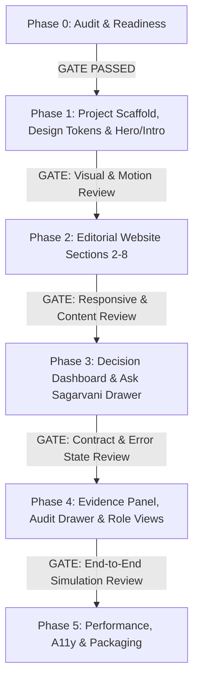

# SAGARVANI / ORCA — PHASE 0: FRONTEND REPOSITORY AUDIT & IMPLEMENTATION READINESS

**Audit Date:** 2026-10-25  
**Auditor:** Antigravity AI Engine  
**Project:** Sagarvani / ORCA — Evidence-Aware Marine Decision-Intelligence Platform  
**Status:** Audit Completed — Implementation Gated  

---

## 1. Workspace and Existing Project Structure

Inspection of `c:\Users\syeda\Desktop\Sagarvani Reconstructed` reveals a clean separation between the verified backend, documentation/design assets, and historical legacy references:

```text
Sagarvani Reconstructed/
├── backend/
│   ├── .venv/                     # Python 3.12 virtual environment (uv managed)
│   ├── artifacts/                 # Local run artifacts & test outputs
│   ├── core/                      # Configuration, settings, logging, telemetry
│   ├── engine/                    # FSM execution engine, Laya adapter, guardrails
│   ├── models/                    # Pydantic contracts (CanonicalQueryRequest/Response, Enums, Evidence)
│   ├── routers/                   # FastAPI routes (health, orca/query)
│   ├── tests/                     # 168 unit & integration tests (100% passing offline)
│   ├── main.py                    # FastAPI entrypoint
│   └── sagarvani.db               # SQLite operational store
├── docs/
│   ├── Sagarvani-Design Reconstruction/ # Extracted approved visual bundle
│   │   ├── DESIGN GENERATED/      # 46 original high-res illustration PNGs
│   │   ├── SVGs/                  # Haikei waves & decorative vector assets
│   │   ├── Board 01 - Website Layout.png
│   │   ├── Board 02 - Dashboard Layout.png
│   │   └── Board 03 - Component System.png
│   ├── MASTER_BLUEPRINT.md        # Architectural authority
│   ├── BUILD_PLAYBOOK.md          # Multi-phase execution plan
│   ├── DATA_AND_QUALITY.md        # Marine validation thresholds & criteria
│   ├── ENGINEERING_LOGBOOK.md     # Verifiable audit record of architectural decisions
│   ├── FRONTEND_IMPLEMENTATION_HANDOFF.md # UX/UI handoff & 30-component map
│   └── Sagarvani_Accessible_UX_Animation_Spec_v2.md # Motion & interaction specs
├── frontend/                      # TARGET DIRECTORY FOR GREENFIELD BUILD
│   └── AGENTS.md.md               # Directory marker / instructions
└── legacy/
    └── Sagrvani Complete/         # Reference-only codebase (contains obsolete Next.js prototype)
```

### Critical Findings:
- **`frontend/` is completely greenfield:** Aside from an informational markdown file, no package manifest (`package.json`), source tree (`src/` or `app/`), or dependencies exist in `frontend/`. 
- **Legacy code is reference-only:** `legacy/Sagrvani Complete/frontend` exists as historical context. It relies on unverified schemas and endpoints that do not exist in the current backend. It must **not** be linked, imported, or migrated directly.
- **Zero dependency conflicts in current root:** The project root has no conflicting Node modules or global configs.

---

## 2. Design Archive — Inspected Visual Assets

Visual verification was conducted across all boards and source asset folders:

### 2.1 Approved Design Boards
1. **Board 01 — Website Layout (`Board 01 - Website Layout.png`):**
   - **Type:** Editorial, ukiyo-e-inspired public homepage.
   - **Palette:** Warm ivory base (`#FAF7F0`), deep lapis/indigo contrast (`#1B4F8A`, `#2D3A8C`), azure accents (`#4A90D9`), and icy blue cards (`#B8D4E8`).
   - **Layout:** Long-form single-page structure consisting of 8 distinct numbered sections: Hero with intro animation, Crisis Narrative, Core Pillars, Multi-Role Decision Intelligence, Live Evidence Preview, Interactive Voice/Advisory Simulator, Case Studies / Impact, and System Trust Footer.
2. **Board 02 — Dashboard Layout (`Board 02 - Dashboard Layout.png`):**
   - **Type:** Deep navy decision-cockpit (`#0B132B`, `#1C2541`).
   - **Core Areas:**
     - Left / Center: Interactive Map area with stylized bathymetric/coastal textures labeled clearly as `"ILLUSTRATIVE ART — NOT NAVIGATIONAL"`.
     - Right Panel: "Ask Sagarvani" interactive query drawer with quick-prompt chips.
     - Lower Drawer / Split View: Structured Evidence Panel showing source attribution, observation timestamps, confidence scores, and policy audit verdicts.
3. **Board 03 — Component System (`Board 03 - Component System.png`):**
   - **Type:** Design token library, atomic components, and status legend.
   - **Status Categories:** 
     - *Use / Selected:* Direct production-ready UI components.
     - *Adapt / Style:* UI components requiring theme token alignment.
     - *Verify Backend:* Components strictly contingent on live API evidence.
     - *Optional Experiment:* Future prototype features.

### 2.2 Art and Graphic Assets
- **46 High-Resolution PNG Illustrations:** Fully present in `docs/Sagarvani-Design Reconstruction/DESIGN GENERATED/`. Average size: 2.1 MB – 3.8 MB. (Must be optimized via `next/image` to WebP/AVIF).
- **SVG Wave Assets:** `layered-waves-haikei.svg` and `wave-haikei.svg` located in `SVGs/` folder, ready for seamless section dividers.
- **Sprite Sheet:** `Ukiyo-e Fishing Boat Wave Cycle.png` identified for horizontal scrolling animation sequences.
- **Reverse-Engineering Reference Note:** External notes referencing `maritime.sh` represent domain research for maritime data models, **not** Sagarvani UI components. Sagarvani adheres strictly to its locked 30-component catalog.

---

## 3. Frontend Framework, Routes, and Dependency Plan

### 3.1 Recommended Architecture
- **Framework:** Next.js (App Router, React 19, TypeScript).
- **Styling:** Tailwind CSS 4 with custom semantic design tokens (ivory, indigo, lapis, azure, seafoam, alert corals).
- **Animation Strategy:**
  - Micro-interactions & layout reveals: Framer Motion.
  - Canvas wave dynamics: Lightweight vanilla HTML5 Canvas or SVG path manipulation.
  - *Constraint:* Avoid installing duplicate/competing animation engines (GSAP + anime.js + Framer Motion simultaneously).
- **Accessibility:** Mandatory `prefers-reduced-motion` compliance. All animated sections (e.g., Intro Sequence, Floating Vessels) must gracefully fallback to static high-contrast layouts.

### 3.2 Route Architecture
- `/` — Editorial Public Showcase (Board 01: Long-form narrative with interactive simulator).
- `/dashboard` — Marine Decision Intelligence Cockpit (Board 02: Evidence viewer, query bar, audit drawer).
- `/advisory/[run_id]` — Shareable canonical advisory record (audit proof sheet).

---

## 4. Artwork Availability & Phase 1 Asset Mapping

All illustrations required for Phase 1 are confirmed on disk:

| Component | Target UI Element | Source Artwork Filename |
|---|---|---|
| **Hero / Intro** | Opening ocean vista | `Indian Ocean Dawn Ukiyo-e Horizon.png` |
| **Hero Backdrop** | Wave motif & depth | `Tide Surge Japanese Block Print Style.png` |
| **Vessel Motion** | Boat traverse cycle | `Ukiyo-e Fishing Boat Wave Cycle.png` |
| **Section Dividers**| Seamless wave transitions | `SVGs/layered-waves-haikei.svg` |

*Rule:* Zero replacement or AI-generated artwork will be introduced. Only approved assets from `DESIGN GENERATED/` will be copied into `frontend/public/artwork/`.

---

## 5. Actual Backend Endpoint & Schema Audit

Live backend audit conducted against `backend/main.py` and `backend/models/`:

### 5.1 Route Inventory

| Endpoint | Method | Status | Notes |
|---|---|---|---|
| `/health` | GET | **Active & Verified** | Returns `{"status": "healthy", "version": "..."}` |
| `/api/orca/query` | POST | **Active & Verified** | Primary decision engine endpoint (FSM execution) |
| `/api/runs/{run_id}` | GET | **ABSENT** | Mocked or stored locally in SQLite; needs router in Phase 3 |
| `/api/orca/chat` | POST | **ABSENT** | Conversational queries must route through `/api/orca/query` |
| `/api/weather/marine/*` | GET | **ABSENT** | Raw weather endpoints not exposed; bundled into query evidence |
| `/api/satellite/*` | GET | **ABSENT** | Satellite composites not exposed as standalone API |

### 5.2 Canonical Contract Specification

**Request Contract (`POST /api/orca/query`):**
```json
{
  "query": "Is it safe to fish 15km off Paradip tomorrow morning?",
  "session_id": "sess_20261025_001",
  "stakeholder_role": "fisherman_community",
  "presentation_mode": "field_community",
  "context_override": {
    "location": {
      "latitude": 20.316,
      "longitude": 86.611
    }
  }
}
```
*Note on Request:* `context_override.location` is **strictly required** for spatial evaluation. If omitted, the engine returns `ABSTAINED` with `MISSING_LOCATION`.

**Response Contract (`CanonicalQueryResponse`):**
```json
{
  "run_id": "run_01ha...",
  "trace_id": "tr_01ha...",
  "status": "APPROVED | AMBIGUOUS | CONFLICTING | INSUFFICIENT_EVIDENCE | UNVERIFIED | ABSTAINED | REJECTED_BY_POLICY | ERROR",
  "data_mode": "LIVE_VERIFIED | CACHED_FALLBACK | TEST_FIXTURE | SYNTHETIC | MOCK",
  "evidence": [
    {
      "source_id": "incois_osf",
      "metric_name": "significant_wave_height",
      "value": 2.1,
      "unit": "m",
      "observation_time": "2026-10-25T00:00:00Z",
      "forecast_valid_time": "2026-10-25T06:00:00Z",
      "confidence": 0.92
    }
  ],
  "warnings": [],
  "gaps": [],
  "policy_audit": {
    "overall_verdict": "PERMITTED | RESTRICTED | PROHIBITED | NOT_EVALUABLE",
    "checks": [
      {
        "check_id": "vessel_threshold_check",
        "verdict": "PERMITTED",
        "explanation": "Wave height within standard artisanal limits."
      }
    ],
    "explanation": "Audit summary text."
  },
  "summary_text": "Conditions favorable for artisanal craft until 11:00 AM.",
  "field_view": {
    "headline": "Safe for nearshore fishing",
    "audio_ready_text": "..."
  },
  "professional_view": {
    "synoptic_rationale": "..."
  },
  "timestamp": "2026-10-25T02:54:00Z",
  "disclaimer": "Advisory only. Always consult official port and IMD bulletins."
}
```

### 5.3 Backend Verification Results
- **Test Suite Status:** Executed `.venv\Scripts\python.exe -m pytest tests/ -q --tb=short` → **168 passed, 2 skipped, 1 warning (6.86s, 100% offline, zero network leakage)**.
- **CORS Config:** Configured for `http://localhost:3000` and `http://127.0.0.1:3000`.

---

## 6. Capability Matrix

| Feature / UI Component | Backend Status | Frontend Readiness | Plan |
|---|---|---|---|
| Query Submission | **Verified** (`POST /api/orca/query`) | Ready | Primary form submission |
| Role Selection (8 roles) | **Verified** in Enum | Ready | Dropdown & Quick-filter chips |
| Presentation Switch (Field / Pro) | **Verified** in Request/Response | Ready | Dual-tab view toggle |
| Evidence Lineage Card | **Verified** (`evidence[]`) | Ready | Direct data-binding to cards |
| Policy Audit Breakdown | **Verified** (`policy_audit`) | Ready | Render verified checks and warnings |
| Data Mode Badge | **Verified** (`data_mode`) | Ready | Prominent badge: Live vs Fixture |
| Interactive Map (Navigational) | **NOT AVAILABLE** | Unsafe | Render as "Illustrative Art" with disclaimer |
| Real-time Alert Dispatch (SMS/IVR) | **PROHIBITED** in dev | Blocked | Mark as "Simulated Dispatch" only |
| Protected Marine Area (MPA) Check | **NOT_EVALUABLE** | Gated | Display "Requires certified geometry source" |
| Audio Playback | Client TTS / Mocked | Ready | Web Speech API fallback |

---

## 7. Features That Must Be Marked "Coming Soon"

To preserve scientific and regulatory integrity, the following features visible on design mockups must be rendered with disabled/informative "Coming Soon" badges:

1. **Certified Navigational Charting:** No official electronic navigational charts (ENC) are licensed.
2. **Automated Coast Guard Dispatch:** Direct SOS or SAR integration is restricted.
3. **High-Resolution Satellite SAR Imagery:** Standalone live radar feed is unintegrated.
4. **Automated WhatsApp / SMS Broadcast System:** Alert dispatch is safely mock-gated.
5. **Hyper-local Micro-inlet Tide Prediction:** Beyond official gauge extrapolation.

---

## 8. Risks, Incompatibilities, and Gaps

1. **Location Requirement:** Frontend must automatically provide fallback coordinates (e.g. Paradip Port: `20.316, 86.611`) if geolocation is rejected by user, or FSM will return `ABSTAINED`.
2. **Heavy Illustration Bundle:** 46 PNGs total ~120 MB. Must implement lazy loading and modern format conversions (`next/image`).
3. **Components 1–6 Definition:** Handoff explicitly itemizes Components 7–30. Components 1–6 correspond to base shell structures (Nav, Shell, Base Card, Hero, Footer, Theme Provider) which must follow strict design tokens.
4. **Strict Color Adherence:** The website must **not** default to a dark dashboard theme. The public page must use the warm ivory editorial system (`#FAF7F0`).

---

## 9. Recommended Phase Order and Acceptance Gates



- **Phase 0 (Current):** Repository audit, asset inventory, backend verification. (Gate: User approval of this audit).
- **Phase 1:** Greenfield Next.js scaffold in `frontend/`, design token configuration, Navigation, Hero section, and Intro ocean animation with reduced-motion fallback.
- **Phase 2:** Complete editorial public site (Sections 2 through 8 from Board 01).
- **Phase 3:** Dashboard core layout (Board 02), Illustrative Map display, "Ask Sagarvani" drawer, and backend client wiring.
- **Phase 4:** Evidence panel, Policy Audit breakdown, Field vs. Professional view toggles, and "Coming Soon" badges.
- **Phase 5:** End-to-end integration tests, lighthouse accessibility audit, asset optimization, and packaging.

---

## 10. Exact Files to be Touched in Phase 1

When Phase 1 begins, changes will be restricted solely to the `frontend/` directory:

```text
frontend/
├── app/
│   ├── layout.tsx                 # Root layout with fonts & meta
│   ├── page.tsx                   # Public homepage container
│   └── globals.css                # Semantic color tokens & typography
├── components/
│   ├── Navigation.tsx             # Floating pill navigation
│   ├── Hero.tsx                   # Opening editorial hero
│   └── IntroAnimation.tsx         # Wave reveal canvas / motion sequence
├── public/
│   └── artwork/
│       ├── Indian Ocean Dawn Ukiyo-e Horizon.png
│       ├── Tide Surge Japanese Block Print Style.png
│       ├── Ukiyo-e Fishing Boat Wave Cycle.png
│       └── layered-waves-haikei.svg
├── package.json                   # Dependencies: next, react, framer-motion, lucide-react
├── tsconfig.json                  # Strict TypeScript configuration
└── tailwind.config.ts             # Sagarvani custom theme palette
```

**Zero backend files will be altered in Phase 1.**

---

## 11. Audit Summary & Sign-off

- **Backend Health:** Operational (168 tests passing, `/health` and `/api/orca/query` verified).
- **Asset Readiness:** 100% of required art and vectors present on local disk.
- **Architectural Clarity:** Full alignment between canonical backend schemas and frontend presentation models.

**PHASE 0 AUDIT COMPLETE — AWAITING USER APPROVAL TO COMMENCE PHASE 1 SCAFFOLDING.**
