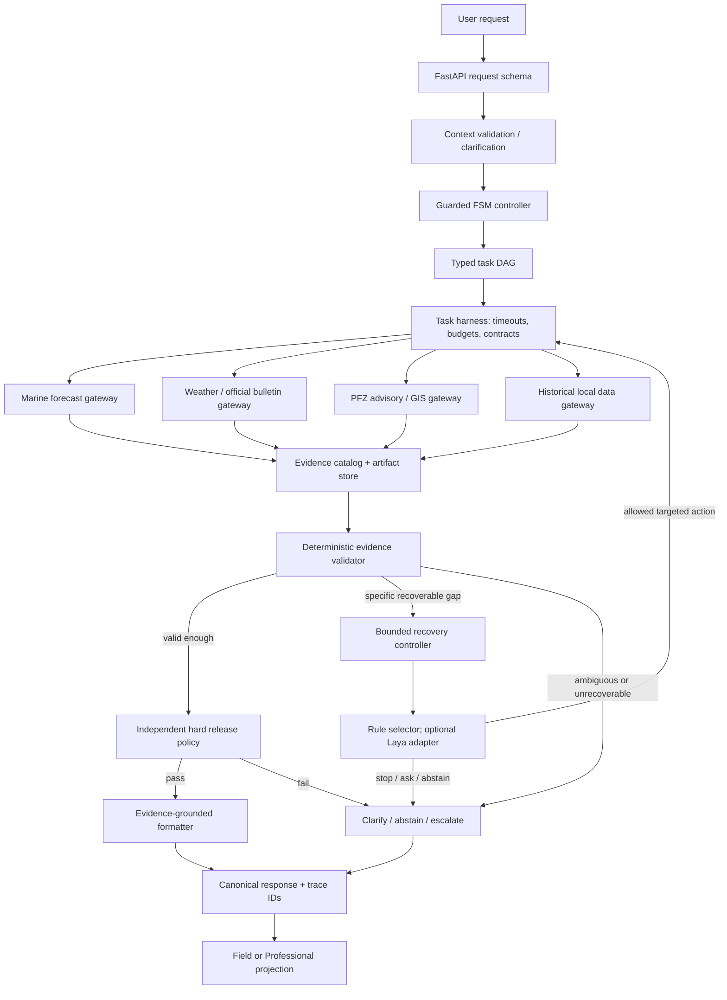

# Sagarvani / ORCA — Complete Engineering Master Blueprint

**Version:** 1.0 — consolidated build plan  
**Planning date:** 23 October 2026 (IST)  
**Immediate build window:** Saturday, 24 October 2026; finalist presentation expected Sunday, 25 October 2026  
**Primary implementation environment:** Google Antigravity (Claude Pro is not a dependency)  
**Repository audited by the supplied report:** `c:\Users\syeda\Desktop\PROJECTS\Sagrvani Complete`  
**Status:** Architecture and build decisions; not a claim that the planned components have already been implemented.

---

## 0. How to read this document

This is the single source of truth for the technical direction. It consolidates the supplied **Outstanding Verification & Loop Architecture Research Report**, earlier project decisions, and a small amount of current documentation research.

Labels used throughout:

- **AUDIT-REPORTED** — a finding in the supplied Antigravity audit. Antigravity must reconfirm it against the current checkout before changing code.
- **VERIFIED DOCUMENTATION** — supported by official/current public documentation linked below.
- **DESIGN DECISION** — our selected architecture, not something the current code is assumed to implement.
- **OPEN GATE** — cannot be treated as solved until evidence or an authorized person is available.
- **DEMO-ONLY** — useful for the hackathon prototype, not certified operational marine advice.

Important: I have reviewed the audit report, not independently executed the Windows repository. Do not treat every line of the audit as a fresh code execution by ChatGPT. Antigravity should re-open the actual files before editing. Never print `.env`, tokens, phone numbers, keys, or any other secrets into chat or logs.

## 1. What Sagarvani is

### 1.1 Product definition

**Sagarvani is a conversational marine decision-intelligence platform that brings relevant marine, weather, geospatial and advisory evidence into one traceable decision workflow, adapts the presentation to the user's role, and explicitly withholds a conclusion when the evidence is inadequate or unsafe to interpret.**

Working pitch:

> Sagarvani turns fragmented marine information into context-specific, evidence-backed decision support—and knows when the evidence needs to be checked again before it responds.

This is not “a chatbot that answers ocean questions.” The core product is the **evidence workflow**: retrieve → normalise → check freshness and comparability → identify conflicts and missing evidence → recover with a specific bounded action → validate again → pass or fail a deterministic release gate → explain the result with provenance.

### 1.2 Eight audiences, one decision engine

1. Fishermen and coastal crews — departure context, marine conditions, official advisories, possible fishing-zone information.
2. Marine and port operators — approach and route context, berth/operational conditions, hazard zones.
3. Researchers and scientists — source comparisons, historical datasets, metadata and exports.
4. Disaster management and safety teams — official warnings, coastal-impact context and evidence trace.
5. Aquaculture and coastal farmers — water temperature, water-quality-related evidence when actually available, data gaps.
6. Coastal tourism and recreation — beach/ferry/watersport context using appropriate authoritative sources.
7. Offshore energy and marine industry — operational windows and environmental context when appropriate engineering data exists.
8. Marine policy and conservation bodies — jurisdiction and protected-area evidence where verified boundaries exist.

These personas are product projections over **one shared backend evidence and policy path**. Do not create eight separate safety decision engines.

### 1.3 Two presentation modes, same underlying decision

- **Field / Community View:** mobile-first, plain language, clear warning and uncertainty labels, low cognitive load, language/audio options later.
- **Professional / Analysis View:** detailed evidence, charts, layers, source lineage, validity windows, filters and exports.

Changing persona or display mode must never change the raw evidence, validation rules, gate result or status of live/historical/demo data. It changes what is emphasised and how it is explained.

### 1.4 Product boundaries for this prototype

Build a working, honest prototype of marine evidence intelligence. Do not claim that it is an operational maritime safety service, official IMD/INCOIS replacement, certified sea-going guidance, validated evacuation tool, or validated vessel sea-keeping system. “GO / STAY ASHORE” can imply real safety authority; until thresholds and workflows are approved by qualified marine authorities, use explicit prototype statuses such as `EVIDENCE_READY`, `OFFICIAL_WARNING_FOUND`, `INSUFFICIENT_EVIDENCE`, `HISTORICAL_REPLAY`, or `DEMO_ONLY` and display the proper disclaimer.

---

## 2. Current state: what exists, what does not, and what it means

The supplied audit describes a partially implemented repository with a polished frontend and backend components that are not yet connected into one trustworthy vertical slice.

### 2.1 Existing components worth inspecting and selectively reusing

**AUDIT-REPORTED candidates:**

- A frontend built with Next.js/React and a dark, technical visual language.
- `backend/engine/orca_pipeline.py` — current monolithic path used by `/api/orca/chat` and `/api/orca/query`.
- `backend/agents/orchestrator.py` — a competing path that invokes specialist agents, reportedly not called by the frontend.
- `backend/utils/geo_utils.py` — route detour geometry code.
- `backend/engine/safety_gate.py` — a safety gate component to audit before reuse.
- `backend/engine/multi_objective_ranker.py` — candidate ranking code.
- `backend/parsers/nc_parser.py` — NetCDF parser.
- An Open-Meteo processor/gateway path, to be corrected and verified.
- Local MOSDAC directories, which can support clearly labelled historical replay only.
- Frontend WebGL/style assets and the eight profile cards.

Do not reuse any of these simply because the filename sounds right. Test behaviour, inputs, units, timestamps, attribution and failure modes. Preserve good geometry and rendering code if it passes tests; replace misleading behaviour rather than wrapping it in more agent calls.

### 2.2 Audit-reported gaps and risks

- Two backend orchestration paths diverge; the path the UI actually calls does not use the specialist agent path.
- UI scenarios, voice interactions, map details and parts of the response path use fixture data or canned timers rather than verified backend evidence.
- A frontend failure catch reportedly fabricates a reassuring advisory when the backend call fails. **This must be removed.**
- Open-Meteo values are at places attributed to INCOIS/IMD incorrectly. **Source attribution must be truthful.**
- Evidence confidence and times are partly fabricated; these values must not be carried into the new evidence contract.
- Existing PFZ entries are static and reportedly expired; do not rank them as current.
- Current NetCDF files have 2026 dates but empty global attributes; dates and provenance are not enough to certify them as valid live observations. Treat them as historical/demo fixtures unless independently proven otherwise.
- SARAL/AltiKa sample data is dated June–July 2016; historical replay only.
- The Bhuvan folder reportedly contains documentation PDFs, not actual GIS geometries. A protected-area check cannot pass using a name or a hand-waved point coordinate.
- Gemini import/SDK mismatch reported; template output is a more reliable starting point than an unverified model fallback.
- Alert endpoints reportedly can dispatch real Twilio messages without sufficient authentication, and a tracked test file contains a live phone number. Never run that test as-is.
- README reportedly claims tests/state infrastructure that are not present. Treat README claims as untrusted until reconciled with actual source and test output.

### 2.3 The thing we are actually rebuilding

We are **not** rebuilding every UI component and not adding six agents just to say there are six agents. We are creating one small, testable, auditable **canonical backend vertical slice** and selectively connecting proven data and frontend components to it.

### 2.4 Repository inventory check is the first Antigravity action

Before modifying anything, Antigravity must inspect the current branch/status, route registrations, dependencies, test commands, actual UI call paths, alert endpoints, and data files. Confirm current paths and line numbers because audit line numbers may have shifted. No destructive git commands; no blanket rewrites; no secret output.

---

## 3. The target architecture

### 3.1 Major components

1. **API layer** — request validation, session/run IDs, rate limits, consistent HTTP errors.
2. **Context interpreter** — extracts stated location/time/persona/request parameters; it cannot invent missing coordinates or a vessel type.
3. **Task planner / DAG builder** — creates a small typed graph of only the tasks relevant to the query.
4. **Execution harness** — executes independent tasks concurrently; validates schemas; applies timeout/budget; records handoffs and results.
5. **Data gateways** — narrowly scoped clients for each API or local dataset. Gateways return typed data and source metadata, not prose claims.
6. **Evidence store and catalog** — artifacts on disk; SQLite for run/evidence metadata and lookup; no Redis or vector database in the MVP.
7. **Evidence validator / critic** — deterministic checks of fields, units, timestamps, spatial bounds, freshness, source lineage and missing/conflicting evidence.
8. **Bounded recovery controller** — proposes one allowed corrective action against a specific unresolved gap; it cannot execute arbitrary tools/code.
9. **Laya selector adapter (R1)** — optional structured chooser from an allow-list. It is an experimental selector, not an LLM replacement for physical models and not a safety gate.
10. **Hard release policy** — separate deterministic pass/withhold gate, with veto authority over all model-generated text or choices.
11. **Advisory formatter** — creates a source-cited summary, preferably using deterministic templates in MVP. Optional LLMs may assist wording later, but cannot decide physical hazard or override gates.
12. **Trace/observability** — an append-only structured run record containing state changes, actions, tool arguments, source refs, errors, durations and policy result. Do not persist hidden chain-of-thought.
13. **Frontend projection contract** — returns a canonical decision and evidence once; Field and Professional modes render it differently.

### 3.2 Architecture diagram



The “loops” are the FSM-controlled return to acquisition via recovery and the bounded refinement loop. The DAG itself is a task-dependency graph, not an infinite loop. The hard gate is separate so no selector, model or critic can overrule it.

### 3.3 Request lifecycle states

Use an explicit enum and a transition function. Proposed states:

- `REQUESTED`
- `CONTEXT_VALIDATED`
- `CLARIFICATION_REQUIRED` (terminal for this run unless new user input creates a new run)
- `TASK_GRAPH_READY`
- `EVIDENCE_ACQUISITION`
- `EVIDENCE_VALIDATION`
- `RECOVERY_PLANNING`
- `SAFETY_GATE_CHECK`
- `ADVISORY_SYNTHESIS`
- `RELEASED` (prototype output; not formal certification)
- `ABSTAINED`
- `REJECTED_BY_POLICY`
- `FAILED`
- `TIMED_OUT`

Rules:

- Only the FSM code may transition states.
- Every state transition gets a timestamp, reason code, and run ID.
- Every asynchronous task has a time budget. If the system cannot get required evidence in time, it returns a truthful partial/abstention result instead of inventing values.
- Terminal states cannot restart the same run. A new request creates a new run ID.
- Recovery count and elapsed time are enforced in code, not only in prompts.
- Recovery cap starts at `N_MAX_RECOVERY = 2` for the prototype and can be changed only through tested configuration.
- “We retried” is not progress. Record which gap should improve before selecting an action; stop if the same source, timestamp, schema and gap return again.

---

## 4. The loop patterns: exactly what they do in Sagarvani

The loop research is part of the implementation—not an appendix and not a claim that multiple loops should run independently without control.

### 4.1 Loop A — Guarded deterministic FSM (outer control loop) — ADOPT NOW

**Responsibility:** Own request lifecycle, permitted transitions, timeouts, recovery budget and terminal statuses.

**Not responsible for:** Interpreting every sentence creatively, computing wave physics, or writing the final prose.

**Implementation:** Python enum + transition table or explicit transition function; Pydantic schemas for transition events; unit tests for every valid and invalid transition. No LLM decides the next FSM state.

**Termination:** success, clarification, abstention, policy rejection, error or timeout. Infinite control loops are structurally prevented.

### 4.2 Loop B — Plan-and-execute DAG / conditional replanning — ADOPT NOW

**Responsibility:** Run independent fetch/parse tasks concurrently and wait for dependencies. For example, a weather request and an eligible local NetCDF parse can run in parallel; a geofence route check waits until route geometry exists.

**Implementation:** A small in-project task graph and `asyncio`/structured concurrency first; task nodes carry typed input/output contracts. Do not introduce LangGraph, CrewAI, Celery or Redis simply because the project uses the word “agent.”

**Replanning:** Only rebuild/rerun the relevant downstream portion when an upstream task failed or a validator names a recoverable evidence gap. Do not rerun every agent.

**Termination:** All required nodes complete, a deadline expires, or a required node fails and cannot be recovered.

### 4.3 Loop C — Evaluator/critic + bounded recovery (R3) — ADOPT NOW

The term “critic” here means an evidence validator. It is primarily deterministic—not an LLM asked to judge whether another LLM sounds confident.

1. Validator emits a structured gap, e.g. `STALE_EVIDENCE`, `MISSING_OFFICIAL_WARNING`, `UNIT_MISMATCH`, `SOURCE_LINEAGE_DUPLICATE`, `AMBIGUOUS_LOCATION`, `SCHEMA_INVALID`.
2. Recovery controller maps that gap to an allowed action.
3. Harness executes one action with permissions and budgets.
4. Evidence state is updated; the validator runs again.
5. If the gap is unchanged, action repeats without expected progress, or the recovery budget is exhausted, the run abstains/asks/escalates.

**Important correction:** Recovery cannot be required to always make a numeric “gap size” smaller. Use a typed progress signal: fixed fields improved, an independent fresh source arrived, parse validity changed, ambiguity was resolved, or the system moved to a legitimate terminal status. Avoid a made-up scalar gap metric unless it has a defined and tested meaning.

### 4.4 Loop D — ReAct/tool loop — RESTRICTED, NOT A GENERAL OUTER LOOP

ReAct-style action/observation can be useful inside a specialist parser later, but MVP gateways should use known endpoints, typed parameters, fixed schemas and a strict one-retry policy for transient failures. No free-form model tool routing across the whole repository or web.

Never allow external bulletin text or user prompts to modify tools/permissions. Never expose or store hidden chain-of-thought. Store structured `action`, `arguments`, `observation_summary`, `artifact_refs`, `duration_ms` and result codes instead.

### 4.5 Loop E — Generator/critic text refinement — OPTIONAL PRESENTATION ONLY

Later, an LLM may draft a concise summary, and a separate formatting check can verify that each claim points to an evidence ID and that the draft does not invent values. The deterministic gate must run before and after formatting; formatting never upgrades an abstention to “safe.” For the hackathon, deterministic templates can ship without a paid LLM.

### 4.6 Loop F — Reflexion / episodic learning — OFFLINE ONLY

Use feedback from test runs to improve test cases, examples and developer guidance. Do not let runtime reflections change safety thresholds or policy automatically. Changes to rules require a code review, domain review where appropriate, and regression tests.

### 4.7 Loop G — Queue/worker and scheduled ingestion — DEFER FOR INTERACTIVE MVP

Useful later for scheduled source refresh, large historical imports, and authorized alert delivery. Not needed in a synchronous chat request. Because existing alert routes are reportedly unsafe, all real SMS/WhatsApp dispatch should stay disabled/mocked until authentication, consent, rate limiting, audit, recipient authorization and provider sandboxing are proven.

### 4.8 Loop H — Ralph/coding-agent loop — DEVELOPER TOOL ONLY

This is an engineering iteration method: change → run objective tests → inspect diff → repeat with a cap. It is not a Sagarvani runtime component. Antigravity can work in small test-driven phases without invoking an autonomous endless code loop.

### 4.9 The nesting rule

Only one runtime component owns control: **FSM → task graph/harness → validator → bounded recovery → FSM**. Laya may recommend one recovery action. It does not start its own open-ended sub-loop. The release gate is outside the selector's authority. This prevents loops fighting each other or bouncing indefinitely.

---

## 5. The three refactors (R1 / R2 / R3) and their actual integration points

### R1 — Laya decision adapter (keep in the plan; experimental integration)

**Decision: Laya will be part of the architecture as an optional structured recovery-action selector. It is not being dropped.**

Laya's official project describes it as a multilingual, non-autoregressive System 1 decision engine for typed choices, scores and yes/no decisions over structured state. Its role is complementary to a generative LLM: choose among known options, not create a long response. Official docs: [Laya repository](https://github.com/NandhaKishorM/laya), [documentation index](https://github.com/NandhaKishorM/laya/blob/main/docs/index.md), [benchmark report](https://github.com/NandhaKishorM/laya/blob/main/BENCHMARKS.md).

**Where it fits:** `RECOVERY_PLANNING` only.

**What it receives:** a compact validated JSON summary of the unresolved evidence gap, previous actions and available allowed actions. It must not receive secrets or unrestricted file access.

**Allowed choices (initial proposal):**

- `TRY_SECONDARY_SOURCE`
- `RETRY_TRANSIENT_FAILURE` (only for a transient failure, max once per source/task)
- `REPARSE_WITH_KNOWN_SCHEMA` (only if raw evidence exists and parser failure is plausibly recoverable)
- `REQUEST_USER_CLARIFICATION`
- `ESCALATE_TO_AUTHORITY`
- `ABSTAIN_INSUFFICIENT_EVIDENCE`

Do not offer `DECLARE_SAFE`, `OVERRIDE_GATE`, arbitrary code execution, arbitrary URL fetching, or unsupported physical-risk probabilities as options.

**Integration shape:** `RecoverySelector` protocol → `RuleBasedRecoverySelector` is the default → `LayaRecoverySelector` implements the same protocol behind `LAYA_SELECTOR_ENABLED`. Keep import/load errors contained at the adapter boundary. If Laya is unavailable, invalid, times out or returns an unrecognised action, use the deterministic rules fallback and log `selector_fallback_reason`.

**Build it in stages:**

1. Create the interface, input/output schema and feature flag now.
2. Build the deterministic rules selector and tests first.
3. Install Laya only inside the project-managed environment with `uv`; check the installed version and the current official dependency/weight requirements first. Do not make the entire backend depend on model weights being downloaded.
4. Evaluate same held-out cases against B2 rules. Test option-order effects, confidence/calibration if probabilities are used, timeout, missing weights, malformed output, English and relevant Indic languages.
5. Enable Laya selection only if it meets predeclared test criteria and never violates the fixed allow-list. The hard gate still has final authority.

**How to present it honestly:** “Sagarvani uses an emerging structured decision engine as an experimental policy selector inside a bounded evidence-recovery harness; a deterministic gate independently controls release.” Do not claim nobody else uses Laya or that its use alone is novel. Do not cite general Laya benchmark numbers as evidence of marine-domain performance. The benchmark repository itself shows the base checkpoint below the reported majority baseline on its typed-decision suite and better numbers for a task-fine-tuned checkpoint; our marine evaluation remains to be done.

### R2 — Sagarvani agent harness / execution control plane

**Responsibility:** Execute typed tasks safely, not “make agents talk to each other” without contracts.

Must provide:

- `run_id`, `task_id`, parent/dependency IDs and actor ID.
- A versioned input and output schema.
- Explicit statuses: `SUCCESS`, `PARTIAL`, `FAILED`, `SKIPPED`, `ABSTAINED`, `TIMED_OUT`.
- Evidence references and artifact paths rather than embedding huge raw payloads in all prompts.
- Allow-listed data access and source-specific gateway clients.
- Timeouts, request limits, max response sizes, retry permissions and per-run deadline.
- Concurrency for independent tasks, deterministic merge of results, and idempotency for retried work.
- Append-only structured trace and error codes.
- Safe local storage first: filesystem artifacts + SQLite metadata. No Redis required for a one-process hackathon MVP.

### R3 — Bounded decision-aware recovery controller

**Responsibility:** Use the validator's structured deficit to choose a targeted next action, then revalidate. It must avoid blind retries and repeated no-progress calls.

Core sequence: `gap_detected → classify_gap → determine_recoverability → select_allowed_action → execute_once → compare_new_evidence → revalidate → continue_or_terminal`.

The controller enforces at least:

- `N_MAX_RECOVERY = 2` at run level for the initial prototype.
- A separate `max_attempts_per_task` (e.g. one retry only for explicitly transient errors).
- Per-gateway timeout and request-size cap.
- Deadline/call budget.
- No repeated identical action on an unchanged failure signature.
- A terminal action for unresolvable gaps.
- No action can invent a measurement, change its timestamp, relabel its source, waive a required official warning, or override the release gate.

### How R1/R2/R3 compose

- **R2** executes the work and provides budgets/state/trace.
- **R3** decides whether recovery is needed and asks for one allowed action.
- **R1** optionally selects the action inside the R3 allow-list; rules remain the fallback and benchmark baseline.

That separation should remain visible in code, docs and the demo narrative.

---

## 6. Evidence and state data model

Never store a giant all-agent prompt as the state model. Maintain a compact run record, a registry of evidence pointers, raw artifacts, and a trace.

### 6.1 Four storage layers

1. **Run state:** current state, recovery count, deadline, persona, display mode, request context and task statuses.
2. **Evidence catalog:** typed metadata and IDs; raw payload stays out of the catalog.
3. **Artifact store:** raw bounded JSON responses, downloaded bulletin files where permitted, NetCDF subset extracts, validated GeoJSON and parser outputs in `artifacts/runs/{run_id}/...`.
4. **Append-only run trace:** state transitions, gateway calls, source identifiers, error codes, latencies, evidence validation results and release-gate decision.

Keep data small, local and inspectable. Avoid vector databases: this MVP's hard problem is valid, comparable and traceable evidence, not semantic document retrieval.

### 6.2 Minimum evidence item contract

Every piece of evidence should have fields equivalent to:

- `evidence_id`, `run_id`, `source_id`, `source_name`, `source_kind`.
- `parameter` and typed `value` (or structured advisory text), `unit` and coordinate reference when applicable.
- `data_kind`: `OBSERVATION`, `FORECAST`, `OFFICIAL_ADVISORY`, `HISTORICAL_ARCHIVE`, `TEST_FIXTURE`, or `USER_PROVIDED`.
- `observed_at`, `issued_at`, `valid_from`, `valid_to`, `retrieved_at` as distinct optional timestamps. Do not substitute one for another.
- `location`/spatial bounds, grid resolution if supplied, requested vs actual point/cell, and spatial uncertainty if known.
- `upstream_parent_ids` or lineage fingerprint for duplicate/common-model detection.
- `source_url`, product/dataset identifier, license/attribution field, raw artifact path and SHA-256 hash.
- `quality_status` and a list of typed quality flags: e.g. `STALE`, `INVALID_SCHEMA`, `OUT_OF_REGION`, `UNKNOWN_LINEAGE`, `HISTORICAL_ONLY`, `SYNTHETIC_FIXTURE`.
- `parser_version` and schema version.

### 6.3 Distinguish time concepts

- **Issued time:** when the source published the forecast or bulletin.
- **Observation time:** when a sensor measurement was made.
- **Valid time/window:** when the value/advisory applies.
- **Retrieval time:** when Sagarvani fetched it.

A new retrieval timestamp does not make an old observation fresh. Forecast validity is checked against the user's requested departure/query time, not merely the wall clock.

### 6.4 Detect false consensus

Two gateways do not represent independent support if they share the same upstream model/dataset/run. A validator should compare lineage where available; if lineage is unknown, say so rather than assuming independence. Do not treat two API endpoints with the same upstream parent as two independent votes.

### 6.5 Task handoff contract

Every task result should include: `run_id`, `task_id`, `parent_task_ids`, `actor_id`, `status`, `schema_version`, `input_refs`, `evidence_refs`, `summary`, `warnings`, `failure_code`, `started_at`, `finished_at` and optional lineage. Raw results belong in an artifact file; task handoffs should stay small.

### 6.6 SQLite tables (minimum)

- `runs`: request metadata, state, timing, status, persona/display mode.
- `tasks`: task IDs, dependencies, status, attempts, errors and duration.
- `evidence`: evidence metadata and artifact pointer.
- `evidence_lineage`: evidence-to-parent relationships.
- `state_transitions`: from/to state, reason, timestamp.
- `recovery_actions`: action, gap IDs, selector source (`RULES` or `LAYA`), validation result, fallback reason.

Use parameterised SQL and migrations. Do not add a database server for the MVP.

---

## 7. Source and dataset plan

The system will prefer an explicitly labelled source over a convenient but incorrectly attributed source. Data availability, access authorization, freshness and redistribution terms must be verified for each product before an adapter is marked live.

### 7.1 Tier 1 — implement or verify first

#### A. Open-Meteo Marine API — primary working secondary forecast for prototype

- Docs: https://open-meteo.com/en/docs/marine-weather-api
- Endpoint family: `https://marine-api.open-meteo.com/v1/marine`
- Useful fields documented: wave height, direction, period, swell, ocean-current velocity/direction, sea-surface temperature, and sea level where available.
- The documentation says forecasts are returned as time series; record the exact variable units and requested timezone/time format.
- Attribution must mention Open-Meteo and the underlying model provider (the cited marine docs note DWD/ICON Wave).
- Reported by the supplied audit: safe read-only GET returned HTTP 200 on 23 October 2026 at a coastal pilot point, but latency was about 3.6 seconds on that test. Re-test during build; network conditions can change.
- Do not label these values as INCOIS or IMD. Do not imply the model resolves local harbour bars, bathymetry or every near-shore hazard.

Official docs: [Marine Weather API](https://open-meteo.com/en/docs/marine-weather-api). Use a separate official weather endpoint if wind/atmospheric variables are required; document the exact model/product returned. If one gateway offers both weather and marine fields, preserve the different product/source metadata.

#### B. INCOIS Potential Fishing Zone (PFZ) advisory — official Indian context

- Official advisory: https://www.incois.gov.in/MarineFisheries/PfzAdvisory
- Text advisory: https://www.incois.gov.in/MarineFisheries/TextDataHome?mfid=1&request_locale=en
- WebGIS: https://www.incois.gov.in/MarineFisheries/PfzWebGis
- The official page explains that PFZ advisories use remote-sensing SST/chlorophyll inputs and are intended as probable fishing-zone information; it also notes that locations can shift and advisories are not issued in all conditions. That means PFZ is a recommendation with a validity period, not proof that fish will be present or a vessel route is safe.
- A current text page was visible in public search on 22 October 2026 with validity through 23 October 2026. Always fetch the actual current issue and its `valid upto` date during implementation; never hard-code this example.
- Preferred integration progression: first link to/inspect the official bulletin and record its issue/validity metadata; then implement a parser only if the page structure can be reliably detected and terms permit it. Reject stale/ambiguous data and surface the source URL. Do not present static PFZ candidate coordinates as live.
- Use the official WebGIS as a corroborating visualization until a documented and robust data endpoint for structured geometry is established.

Official evidence: [INCOIS PFZ Advisory](https://www.incois.gov.in/MarineFisheries/PfzAdvisory), [PFZ Text Data](https://www.incois.gov.in/MarineFisheries/TextDataHome?mfid=1&request_locale=en), [PFZ WebGIS](https://www.incois.gov.in/MarineFisheries/PfzWebGis).

#### C. Existing local NetCDF — historical parser/test fixture only

- Audit-reported current files: `MOSDAC/Global Ocean Surface Current/...` with U/V variables and global 0.25° coordinates; reported timestamps range January–June 2026, but global metadata was empty and provenance was insufficient.
- Audit-reported SARAL/AltiKa coastal products contain June–July 2016 measurements.
- Retain for parser tests, replay and demonstrating a stale-data recovery loop. Add `data_kind=HISTORICAL_ARCHIVE` or `TEST_FIXTURE`; ensure the output cannot appear as a live observation.
- Never “fix” freshness by changing timestamps. Display the actual time from the file metadata and note if authoritative provenance is missing.
- Use `xarray` and the relevant NetCDF engine only if the existing parser requires it; test bounds and coordinate indexing.

### 7.2 Tier 2 — integrate when access is verified

#### D. IMD official coastal / marine warnings

- API reference: https://api.imd.gov.in/public/api_reference.html
- Documented marine endpoints include Port Warning, Sea Area Bulletin and Coastal Bulletin. These can be decision-relevant official warnings.
- The supplied report notes official access/registration requirements; an IMD API document also describes public-IP whitelisting for some endpoints. Verify current authorization with IMD instead of assuming any public URL works from the build machine.
- First step: get authorized access and run one documented read-only test with a non-secret log. If access is unavailable by the demo, render the official IMD source link and mark the backend feed `UNAVAILABLE_NOT_CONNECTED`—do not scrape a different page and claim a connected official API.
- The backend must preserve issue time, validity, warning text, area/port and source URL. If an official warning is missing, unknown or stale, do not display a reassuring “no warning” result.

Official docs: [IMD API Reference](https://api.imd.gov.in/public/api_reference.html). Additional IMD document located during research: [API PDF](https://mausamaudit.imd.gov.in/Forecast/marquee_data/API_doc.pdf).

#### E. INCOIS ERDDAP — investigate datasets one by one

- Catalog: https://erddap.incois.gov.in/erddap/index.html
- `griddap` serves subsets of gridded products; `tabledap` serves subsets of tabular datasets. ERDDAP is useful because the query can identify variables, time and spatial constraints.
- Do not assume every desired variable exists. Inspect the current catalog and each candidate dataset's metadata, spatial coverage, valid time, units and update cadence before building a gateway.
- The audit's test on 23 October 2026 reported TLS certificate verification failure. Do not set `verify=False`. Inspect the actual certificate chain and approved trust configuration with IT/hosting support before retrying.
- Adapter status remains `BLOCKED_TLS` until a normal certificate-verified GET succeeds.

Official docs: [INCOIS ERDDAP catalog](https://erddap.incois.gov.in/erddap/index.html), [tabledap docs](https://erddap.incois.gov.in/erddap/tabledap/documentation.html).

#### F. Real protected-area/coastal GIS boundaries

- The audit says the Bhuvan directory contains documentation PDFs, not usable GeoJSON/shapefile/GeoTIFF geometries.
- Obtain a boundary layer from an official or otherwise permitted, traceable source. Record source, download date, version, CRS, license and geometry validity. Reproject to WGS84 only through a tested transform if needed; do not assume coordinate order.
- `Shapely` can implement point/route-polygon intersections once verified polygons exist. Until then, the MPA gate should return `NOT_EVALUABLE_MISSING_BOUNDARIES`, not `CLEAR`.
- Use the Bhuvan documentation to understand products, not as if the PDFs themselves were a geospatial dataset.

### 7.3 Tier 3 — later / not required for Sunday

- **MOSDAC API/download:** requires account registration and approved access for products; keep local archives historical unless file/product metadata proves otherwise.
- **Copernicus Marine Service:** potentially useful for independent scientific comparison but adds account access, package/setup and larger data workflow. Defer until after MVP.
- **Bhashini / Sarvam / TTS:** relevant for multilingual voice; defer until source-backed answer generation and safety labels are stable. Must never translate away an uncertainty or warning.
- **Satellite/chlorophyll/SST-derived anomaly layers:** future research/analytics after verified data access and quality checks. Do not generate meaningful-looking SST/chlorophyll values from formulas and label them observations.
- **SMS/WhatsApp broadcasts:** disabled/mock for this MVP. Only revisit with explicit authorization, consent, auth, rate limits, audit and provider sandbox tests.

### 7.4 Data acquisition rule

For every adapter, the build notes must list: official docs URL, exact endpoint/product, auth status, license/attribution, source fields, schema, unit mapping, issue/validity semantics, spatial resolution, timeout, retry rule, sample response hash, last safe test time, and a failure-mode test. If any of these are unknown, mark the feed as experimental or unavailable—not verified/live.

---

## 8. Frameworks, tools and dependencies

Use the smallest coherent stack. Antigravity is the coding environment; it is not a backend runtime dependency and does not make Claude Pro necessary.

### 8.1 Backend stack — MVP

| Layer | Choice | Why / boundary |
|---|---|---|
| Language | Python compatible with the current backend environment; standardise on a tested version rather than changing interpreters casually | The audit environment used Python 3.13; check current dependencies before pinning. Laya's current README states Python 3.10+. |
| Environment/dependencies | `uv` with a project `pyproject.toml` and lockfile | Reproducible environment; never install project dependencies globally. |
| HTTP API | FastAPI + Uvicorn | The existing backend is FastAPI according to the audit. Keep one canonical route and typed request/response models. |
| Input/output contracts | Pydantic | Validate requests, task handoffs and evidence results at system boundaries. |
| HTTP clients | `httpx` | Timeouts, status checking, testable API calls. No broad retry loops. |
| Concurrency | Python `asyncio` for independent network tasks | Use bounded concurrency and request timeouts; don't introduce an external orchestrator just for parallel GETs. |
| Local state | `sqlite3` from Python standard library + JSON/raw artifacts in `artifacts/runs/{run_id}/` | Sufficient for the hackathon; no Redis/database server for MVP. |
| Data parsing | `json`, `datetime`, standard library; `xarray`/NetCDF engine for actual local NetCDF files | Add specialist dependencies only for code paths that need them. |
| Geospatial | GeoJSON plus `shapely` when real geometries are obtained | No protected-area clearance without actual validated geometries. Add `pyproj` only if CRS transformations are required. |
| Tests | `pytest`, FastAPI `TestClient`/`httpx`, offline fixtures | Every data source has stubbed deterministic tests; live tests are optional smoke tests, never the sole CI suite. |
| Lint/format | `ruff` | Fast, consistent checks in the same environment. |
| Observability | structured JSON logs + append-only run trace | Do not log secrets or hidden chain-of-thought. |

Official references: [FastAPI testing](https://fastapi.tiangolo.com/tutorial/testing/), [Pydantic docs](https://docs.pydantic.dev/latest/), [Python sqlite3](https://docs.python.org/3/library/sqlite3.html).

### 8.2 Frontend contract (frontend overhaul is not today's priority)

The audit reports a Next.js/React frontend. Keep existing components selectively, but the backend response becomes the only source for decision/evidence values. Use MapLibre/GeoJSON only for map layers whose coordinates are data-backed; the audited hard-coded canvas should not be represented as live GIS. Official docs: [MapLibre GL JS](https://maplibre.org/maplibre-gl-js/docs/), [GeoJSONSource](https://maplibre.org/maplibre-gl-js/docs/API/classes/GeoJSONSource/).

### 8.3 What we deliberately do not add yet

- Redis, Chroma/Pinecone or another vector database.
- LangGraph/CrewAI/AutoGen or several overlapping agent frameworks.
- Celery/RabbitMQ for synchronous query handling.
- A paid hosted LLM as a required runtime dependency.
- Voice and bulk notification stacks.
- Copernicus data stack until it is needed and access is ready.

### 8.4 LLM and narrative generation without Claude Pro

For the hackathon, deterministic templates can make the response from validated data, source citations and policy status. No Claude account is required. An optional `NarrativeProvider` interface can later support an approved model provider (e.g. a compatible hosted service or a local model) for language quality only.

Use configuration such as `NARRATIVE_PROVIDER=template|optional_provider`; safe default is `template`. A model outage must not block evidence retrieval or change the gate. Do not spend build time repairing an unrelated Gemini SDK mismatch unless that model is intentionally selected.

### 8.5 Proposed environment variables

No secrets in committed files. Suggested non-secret configuration keys:

```text
APP_ENV=development
API_BASE_PATH=/api/orca
CORS_ALLOWED_ORIGINS=http://localhost:3000
EVIDENCE_ROOT=artifacts/runs
SQLITE_PATH=artifacts/sagarvani.sqlite3
RUN_DEADLINE_SECONDS=12
GATEWAY_TIMEOUT_SECONDS=6
N_MAX_RECOVERY=2
LAYA_SELECTOR_ENABLED=false
NARRATIVE_PROVIDER=template
IMD_ENABLED=false
INCOIS_ERDDAP_ENABLED=false
PFZ_ADVISORY_ENABLED=false
OUTBOUND_ALERTS_ENABLED=false
```

Only enable a source when its adapter is tested and authorization is confirmed. Actual timeout values can be tuned to measured end-to-end latency; defaults must not be presented as empirically proven performance.

---

## 9. The API contract the backend and frontend will share

### 9.1 Canonical endpoint

- `GET /health` — health only; report application/version and dependency readiness without leaking credentials.
- `POST /api/orca/query` — one canonical query path. The old `/api/orca/chat` can temporarily become a compatibility wrapper, then be retired after tests and frontend migration.
- Optional `GET /api/orca/runs/{run_id}` — read-only run/evidence trace for authorized demo/admin use; add auth if it exposes sensitive data.
- Alert dispatch routes should be disabled or mocked, not exposed publicly.

### 9.2 Request fields

Minimum:

```json
{
  "query": "Summarise the available marine evidence for a coastal location",
  "session_id": "client-session-id",
  "persona_id": "fishermen",
  "display_mode": "field",
  "language": "en",
  "location": {"lat": 13.35, "lon": 74.70, "label": "Malpe, Karnataka"},
  "time_context": {"target_time": "2026-10-24T05:00:00+05:30", "window_hours": 6},
  "vessel_context": {"type": "motorized_craft"}
}
```

This is a schema illustration, not an assertion that the example date/source is a verified live condition. Validate geographic bounds, numeric ranges, ISO 8601 timestamps and supported persona IDs. If critical context is missing, ask for clarification or use a clearly marked non-location-specific response.

### 9.3 Response fields

Minimum fields:

- `run_id`, `status`, `verdict/status_code`, `summary_text`.
- `data_mode`: `LIVE_FORECAST`, `OFFICIAL_ADVISORY`, `HISTORICAL_REPLAY`, `TEST_FIXTURE`, `MIXED`, or `NO_VERIFIED_DATA`.
- `evidence[]`: parameter/value/unit, source name/URL, source kind, issued/observed/valid/retrieved times, quality flags, lineage and artifact reference.
- `gaps[]` and `warnings[]` in machine-readable codes plus human wording.
- `recovery_trace[]`: action, selector (`RULES`/`LAYA`), rationale summary, outcome and recovery counter—not hidden reasoning.
- `policy_audit`: `gate_evaluated`, `gate_passed` or blocked, named checks run, checks not evaluable, policy version.
- `projections.field_view` and `projections.professional_view`, derived from the same result.
- `disclaimer` and `trace_id`.

Do not include fake safety scores or synthetic confidence numbers. If a score is used, document its units/derivation and test; otherwise omit it.

### 9.4 Response statuses must distinguish these conditions

- Source fetch succeeded and returned usable evidence.
- Source fetch failed / blocked / timed out.
- Source data was retrieved but stale or outside validity window.
- Data is historical fixture, not live.
- Evidence items conflict or are not comparable.
- Safety/geospatial policy could not be evaluated because inputs or boundaries are missing.
- User context needs clarification.
- The prototype is only presenting an informational summary, not a certified safety direction.

Never translate `fetch failed` into “no warning,” “sea safe,” or “validated safe.”

---

## 10. Validator and release policy

### 10.1 Deterministic validation stages

1. **Schema:** required keys and types exist; numeric values are finite; unit fields explicit.
2. **Time:** issue/observation/valid/retrieved timestamps distinguishable; target query/departure time lies within validity window; actual age policy applies.
3. **Location:** coordinates are WGS84 and within supported geographic coverage; requested point and model grid/resolution are recorded.
4. **Units/comparability:** e.g. m vs cm, km/h vs knots, UTC vs IST; convert only through named and tested functions.
5. **Source identity/lineage:** correct product attribution; duplicate upstream lineage marked; unknown lineage not assumed independent.
6. **Coverage/missingness:** required variable missing → explicit gap.
7. **Conflict:** conflicting values/alerts are flagged; do not average incompatible sources or allow majority vote to erase an official warning.
8. **Geospatial gate:** only execute if real, versioned and valid polygon/route datasets exist; else `NOT_EVALUABLE`.
9. **Policy check:** apply approved deterministic rules; thresholds must be traceable to a trusted authority/domain expert or clearly labelled experimental.
10. **Release readiness:** assemble only claims supported by evidence IDs; otherwise ask, downgrade the claim or abstain.

### 10.2 Freshness policy is per product, not one universal TTL

The audit suggested candidate thresholds (e.g. wave, current, official cyclone bulletin, PFZ). Treat these as **proposed tuning defaults only**, not approved marine standards. Forecast validity windows and official bulletin validity are more important than an arbitrary age alone. A current forecast issued yesterday may still be valid for tomorrow; an old observation retrieved just now is not fresh.

For each source/variable define:

- `max_retrieval_age` where relevant;
- `valid_time_required` and accepted window;
- `issue_time_max_age` for alerts/bulletins;
- policy on stale input: secondary source, lower information status, or abstain.

A life-safety critical official-warning feed that is unavailable must not silently become “no warning.”

### 10.3 Independent release gate

The release gate is deterministic and has unilateral veto over selector/formatter outputs. It can only say `PASS`, `BLOCK`, or `NOT_EVALUABLE` for configured policy checks. Until a marine expert approves vessel-specific thresholds and official data availability is established, it should not claim certified `GO` or “safe to depart.” It can release an evidence summary with limitations.

---

## 11. Laya evaluation and experiment design

### 11.1 Why Laya belongs without making it a dependency

Laya is a genuine part of the proposed R1 design. We will build the integration seam and evaluate it as a structured selector. We will not claim Laya itself is invented by our team or that it is already a validated marine decision model.

Official starting points:

- [Laya GitHub and quickstart](https://github.com/NandhaKishorM/laya)
- [Laya documentation](https://github.com/NandhaKishorM/laya/tree/main/docs)
- [Laya benchmark report](https://github.com/NandhaKishorM/laya/blob/main/BENCHMARKS.md)

The repository's published benchmark currently distinguishes base and task-fine-tuned checkpoints; its own report shows the base typed-decision checkpoint below its listed majority baseline on that benchmark. That is a reason to evaluate, not a reason to pretend the model cannot be useful. A marine recovery-action dataset is required before any performance claim about Sagarvani.

### 11.2 B0–B4 comparisons

- **B0 — existing baseline:** run only a safe, isolated baseline test; do not execute the audited outbound alert test or rely on a fake UI fallback. Record existing failure modes from static inspection and offline mocks.
- **B1 — fixed bounded retry:** a baseline for retry-only recovery, capped at a small number of attempts.
- **B2 — deterministic recovery rules:** required main baseline; map structured error/gap codes to the action allow-list.
- **B3 — Laya selector:** same cases, same evidence state, same allow-list; Laya changes only action selection. Rules fallback on any model failure.
- **B4 — lineage ablation:** compare B2 with source lineage/common-upstream checks disabled to measure whether lineage catches apparent false consensus. Run only on offline fixtures; never disable lineage in normal demos to make results look better.

### 11.3 Pilot test dataset

Start with a compact set that can be built by Saturday: at least 12 hand-checked cases, one per class below. Expand towards five cases per class (60 total) after the event, and obtain domain-expert labels for domain-critical thresholds.

1. Stale observation / fresh forecast.
2. Contradictory hydrodynamic signals requiring a flag, not an invented physical explanation.
3. Two endpoints share one upstream model (false consensus).
4. Units/CRS mismatch.
5. Wrong forecast validity window.
6. Primary gateway timeout.
7. Malformed response schema.
8. Ambiguous coastal place/location.
9. Critical official cyclone/warning bulletin (fixtures clearly marked).
10. Prompt injection string inside an untrusted bulletin.
11. No-progress recovery loop (same stale source returned again).
12. Benign nominal scenario with complete evidence.

The dataset should preserve fixture origin and expected terminal status. Test prompt injection does not change tool permissions, source labels or gate result.

### 11.4 Metrics

- Recovery action accuracy against a declared reference label.
- Unsafe/unsupported release rate on the test suite (target zero violations in those fixtures; not proof of real-world zero risk).
- Appropriate abstention/clarification rate.
- Recovery termination within configured budget.
- Evidence provenance completeness.
- p50/p95 latency, timeout rate, number of gateway calls and selector failures.
- Results per scenario class and language; no single aggregate number may hide a failing safety-critical class.

Do not treat the report's suggested target latencies or 90/95% thresholds as achieved results. Set thresholds before measurement, record actual counts and errors, and show the dataset size.

---

## 12. Security and reliability lock before integration

These items block any public demo that can send alerts or present the app as a real safety authority.

1. Disable or stub the alert routes until authorized authentication exists; no outbound SMS/WhatsApp calls during tests.
2. Remove tracked real phone numbers from test code; use a mock provider that fails tests if it attempts network dispatch.
3. Restrict CORS to explicit frontend origins. Do not combine wildcard origin with credentialed access.
4. Remove the silent success fallback in the dashboard; show a clear disconnected/unavailable state.
5. Do not log `.env`, tokens, authorization headers or personal contact details.
6. Disable `verify=False`; TLS failure is a failure state until the legitimate trust chain is corrected.
7. Enforce URL/domain allow-lists for gateways, response byte caps and connection/read timeouts.
8. Parse external text as untrusted data. Extract structured fields before sending text to an optional model; no external text can instruct tool use.
9. Validate every task output with Pydantic; model-returned free text cannot name an arbitrary Python function or URL to call.
10. Add per-source request caps and per-run deadlines; no hidden repeat loops.
11. Give historical/demo output an unmistakable banner and actual source date.
12. Keep test data deterministic and tests offline by default; separate opt-in live-smoke tests.
13. Ensure a source outage never turns into a green badge, “no warning” or a fake response.
14. Add authentication to any run trace/admin API that exposes non-public material.
15. Check secret files are ignored and use placeholders in sample environment files.

---

## 13. Build plan, in order

The following order is optimised for a working Sunday demonstration and a maintainable continuation. It deliberately prioritises one end-to-end vertical slice over superficial integrations.

### Phase 0 — Preflight and safety lockdown (first)

- Confirm Git branch, uncommitted changes and exact environment; do not reset/delete user work.
- Inventory real API routes and actual frontend call sites; compare with audit.
- Confirm dangerous alert endpoints and prevent them from sending anything in development/demo.
- Remove hardcoded recipient and disable unsafe test path.
- Fix wildcard CORS / credential combination.
- Remove fabricated frontend fallback; return explicit backend-offline state.
- Run only safe unit tests and import/health checks.

**Exit gate:** no test path can send a real message; backend error cannot result in a fabricated successful advisory; secrets are not emitted.

### Phase 1 — Define the canonical API and contracts

- Add/verify Pydantic request/response schemas.
- Create `run_id`, `trace_id`, `data_mode`, gap/status codes and evidence model.
- Keep `/api/orca/query` as the one canonical route; make legacy paths thin wrappers or disable them once callers migrate.
- Make unknown/missing location, time and persona explicit.
- Add `/health` without secrets.

**Exit gate:** deterministic schema tests and documented sample request/response work offline.

### Phase 2 — Build the first real evidence adapter

- Verify and implement Open-Meteo marine fetch with an explicit timeout, response validation and attribution.
- Map variables into the canonical evidence model; preserve units and forecast time semantics.
- Add stored JSON fixture for reliable tests; add an opt-in live smoke test that never changes expected unit tests.
- Add the PFZ page/source reference and validity metadata only if safely retrievable/parseable; otherwise report it as not connected and link the official source.

**Exit gate:** one query returns a real response or a truthful `SOURCE_UNAVAILABLE` status, never fabricated measurements.

### Phase 3 — Evidence storage and trace

- Create run/artifact directory.
- Write bounded response artifacts and evidence catalog entries into SQLite.
- Capture raw response hash, source URL, retrieved time, schema/parser version and failure code.
- Add lineage fields even if some sources report lineage as unknown.

**Exit gate:** each displayed measurement points to a stored evidence record and raw artifact; historical fixtures remain visibly historical.

### Phase 4 — FSM + harness + DAG

- Implement the explicit state machine.
- Add task contracts, task runner, dependencies and bounded parallelism.
- Use parallel tasks only where independent; task failures produce typed partial results.
- Enforce per-gateway timeout, total deadline, max response bytes and terminal statuses.
- Write transition and task traces.

**Exit gate:** tests prove legal transitions, DAG dependencies, timeout and failure handling; no infinite loop.

### Phase 5 — Validator + R3 recovery + hard gate

- Implement unit/time/spatial/schema/source-lineage checks that can be tested now.
- Treat MPA/geofence checks as `NOT_EVALUABLE` until true boundary data is present and verified.
- Add the allowed recovery action enum and deterministic rules selector.
- Recovery must cite the gap it attempts to fix, avoid repeating identical failed work, and stop at N=2.
- Add a deterministic release policy separate from formatter and selector.

**Exit gate:** stale/missing/contradictory cases abstain or recover transparently; a failed gate cannot emit a green/safe verdict.

### Phase 6 — R1 Laya adapter, behind a feature flag

- Implement selector interface and `RuleBasedRecoverySelector` first.
- Add `LayaRecoverySelector` that can only return allow-listed action names.
- Keep it disabled by default until the local environment, package dependencies and checkpoint load have been verified.
- If there is enough build time, run a small, offline labelled pilot on the same cases as the rules selector. No large fine-tuning task during the finalist build window.
- Show selector choice and whether fallback was used in the structured trace.

**Exit gate:** invalid/timeout/no model cannot block the whole request; Laya never gets release-gate permission; output remains deterministic when disabled.

### Phase 7 — Testing and demo validation

- `pytest` offline suite: schema, adapters, state transitions, recovery limits, source attribution, prompt-injection fixture, missing data, malformed payload, model absent, and no-progress termination.
- Test stale local NetCDF is not labelled live.
- Test that two same-upstream sources do not count as independent confirmations.
- Test that missing GIS polygons produce `NOT_EVALUABLE`, not `CLEAR`.
- Test that backend outage leads to explicit unavailable status.
- Review git diff for unrelated UI changes, secrets, real endpoints and accidental data edits.

**Exit gate:** all selected tests pass; actual pass count and any skipped tests are reported honestly.

### Phase 8 — Frontend connection (coordinate, don't fake)

Frontend work can proceed separately, but it must wait for or consume the canonical contract. Replace fixture results in the primary query path with real `/api/orca/query` response data. Display `data_mode`, timestamps, source URLs, quality flags, gap/recovery state and disclaimers. Both views should reflect the same backend status.

**Exit gate:** a network failure visibly fails; a fixture is labelled a fixture; every number displayed has a source or an explicit illustrative label.

### What not to build before Sunday

- Full real-time IMD registration if approval/IP whitelisting is unavailable.
- A full Copernicus integration.
- Real SMS or WhatsApp alerting.
- All eight profiles as separate deeply specialised workflows.
- A vector database, Redis cluster, complex multi-agent framework, autonomous Reflexion or runtime Ralph Loop.
- New satellite inference models or training.
- Unvalidated safety thresholds dressed up as official advice.

A single working vertical slice with visible gaps and an actual bounded recovery sequence is stronger than a large dashboard that silently uses fixtures.

---

## 14. Proposed backend folder layout

Do not perform a sweeping folder migration on the first pass. Adapt this layout to the current repository after inspecting actual imports. One reasonable target is:

```text
backend/
  main.py                         # FastAPI app / route registration only
  orca/
    api/
      routes_query.py
      routes_health.py
    schemas/
      request.py
      response.py
      evidence.py
      tasks.py
      recovery.py
    controller/
      states.py                   # FSM states and allowed transitions
      run_controller.py
    planner/
      dag.py
      task_registry.py
    harness/
      runner.py                   # timeouts, budgets, task contracts
    gateways/
      open_meteo_marine.py
      open_meteo_weather.py
      incois_pfz.py               # only if access/parse passes tests
      imd_marine.py               # disabled until authorized
      local_netcdf.py
    evidence/
      catalog.py
      store.py
      lineage.py
    validators/
      schema.py
      time_validity.py
      unit_comparability.py
      spatial_coverage.py
      source_independence.py
    recovery/
      selector_protocol.py
      rules_selector.py
      laya_selector.py
      controller.py
    policy/
      release_gate.py
      prototype_rules.py
    presentation/
      formatter.py                # templates first
    observability/
      trace.py
  tests/
    unit/
    integration_offline/
    fixtures/
  artifacts/                      # gitignored run artifacts, except intentional safe fixtures
```

The folder tree is a target, not an instruction to recreate files with identical names if existing working modules can be wrapped safely. Prefer a thin compatibility layer in `main.py`, then move responsibilities incrementally after tests pass.

---

## 15. Antigravity operating protocol (Claude-independent)

Antigravity should work as a careful implementation agent. Give it one phase at a time, not the instruction “build everything” in a single uncontrolled run.

For every phase, require it to report:

1. Files it inspected and files it changed.
2. Its interpretation of the intended behaviour before making a broad edit.
3. Tests run with actual command and outcome; distinguish not run, skipped and passed.
4. Any source access or dependency blockers.
5. Remaining risks/open gates.
6. A small diff that can be reviewed and reverted.

Project rules:

- Do not depend on Claude Pro or Claude verification.
- Do not modify the frontend in backend phases unless explicitly asked.
- Use `uv` for Python dependencies; never global `pip` installs.
- Do not install/download Laya weights until the adapter and baseline selector work.
- Do not run `test_api_endpoints.py` until the outbound dispatch code has been replaced with a mock and proven not to send network requests.
- Never execute actual Twilio, WhatsApp, SMS, paid API, or live alert actions.
- Never use `verify=False` to work around certificate errors.
- Do not invent source fields, live data, source timestamps, GPS positions, confidence values or protected-area geometries.
- Keep models outside the safety gate; no model may transform a missing source into “no warning.”
- Do not claim safety certification, test coverage or patent novelty without evidence.
- No destructive git clean/reset, blanket reformat, entire-repository rewrite or secret printing.

### First Antigravity prompt — start building Phase 0

Copy this first. Do not ask it to create the whole architecture at once:

```text
We are building Sagarvani / ORCA in this repository. Use this file as the architecture source of truth: docs/MASTER_BLUEPRINT.md.

Work ONLY on Phase 0 (preflight and safety lockdown) for this task. Claude Pro is unavailable and must not be a dependency.

First inspect the actual current git status/branch, backend entry points, route registrations, frontend caller paths, CORS setup, all alert/notification dispatch code, and test scripts. The supplied audit may be out of date, so reconfirm every finding from source. Do not print secrets or real phone numbers.

Safety constraints:
- Do not call external SMS/WhatsApp/Twilio or any alert dispatch API.
- Do not run backend/test_api_endpoints.py unless you have first proved that all dispatch paths are mocked and cannot call the network. Prefer not to run it in this phase.
- Do not print .env contents, tokens or authorization headers.
- Do not use verify=False.
- Do not change frontend design in this phase.
- Do not perform destructive git actions or broad rewrites.

Implement only the smallest necessary Phase 0 fixes: disable/mock outbound alert dispatch in development/demo, remove hardcoded real recipient values from tests safely, configure explicit allowed CORS origins from environment/config, and remove any silent fabricated successful advisory on backend failure so the API/UI path reports unavailable honestly. If a fix cannot be safely made without broader context, report it as a blocker rather than guessing.

Use project-managed `uv` if dependency changes are necessary; avoid adding dependencies unless required. Add offline tests that prove the failure path is truthful and alert tests cannot dispatch. Run only safe tests. Finish with: (1) files inspected, (2) files changed, (3) diff summary, (4) exact tests/commands and their actual result, (5) unresolved risks, and (6) confirmation no external alert/network side effects were triggered. Stop after Phase 0; do not proceed to Phase 1.
```

After Phase 0 review, move to Phase 1 with a separate prompt; do not permit an agent to silently roll phases together.

---

## 16. What counts as a successful finalist prototype

A believable demo can show one realistic evidence journey instead of claiming every planned feed is live.

1. A user submits a location/time-oriented marine query.
2. The backend validates context and builds a small DAG.
3. At least one properly attributed live forecast fetch is performed when available; every other source is either verified and connected or honestly marked historical/unavailable.
4. The evidence catalog records variables, units, source URL and valid time.
5. A validator detects a deliberately stale fixture or missing official feed.
6. R3 selects a specific, bounded recovery action; the trace shows it was attempted and whether it improved the evidence.
7. If the gap is fixed, the request progresses to the policy gate; if not, Sagarvani explicitly abstains.
8. The Laya adapter is represented in the architecture and, only if installed and tested, demonstrated as an optional recovery-action selector. Otherwise call it “implemented adapter / integration planned” rather than pretending the model ran.
9. No result can be fabricated by a frontend catch block. A source outage visibly yields `NO_VERIFIED_DATA` or an equivalent truthful state.
10. Same decision data powers both Field and Professional views when the frontend integration is ready.
11. The demo names the current limits: not operational marine safety certification; no MPA clearance until verified boundary geometry and policy exist.

### Short demo story

“Ask about a coastal marine window. Sagarvani retrieves a labelled marine forecast and checks relevant advisory evidence. Its validator notices a stale local current file or unavailable official-warning feed. The recovery controller tries one permitted targeted action; Laya is an optional structured selector for this choice, with rules fallback. The evidence is revalidated. The independent gate allows an evidence summary only when configured requirements pass; otherwise it abstains and tells the user exactly what is missing. Every presented value links to source and time.”

That story demonstrates the architecture more credibly than a canned all-green dashboard.

---

## 17. Research and intellectual-property positioning

The potentially interesting technical direction is not “we use multiple agents” or “we use Laya.” It is the tested design of **evidence-lineage-aware, parameter-comparable, bounded recovery for marine decision-support output, with an independent deterministic release policy**.

Potential elements to study and validate:

- Cross-gateway lineage for shared upstream sources and false consensus detection.
- Typed comparability across units, spatial coverage and valid-time windows.
- Recovery targeted at an identified decision-relevant gap, not generic retries.
- Bounded execution with no-progress termination and auditable traces.
- A release policy that cannot be overridden by a probabilistic selector or text generator.

This is a **research hypothesis**, not a finding that the design is novel, non-obvious or patentable. Prior art already exists for agent tool-use loops, generator/critic workflows, vessel routing, provenance and safety filters. Do not claim exclusive novelty until a qualified patent professional has reviewed the precise implementation, published materials, GitHub/live-demo disclosure dates and relevant laws. The use of the working name “Sagarvani” should also undergo a naming/trademark collision review before any formal product claim.

---

## 18. Official and primary references

- **Laya (official repository, install and structured decision documentation):** https://github.com/NandhaKishorM/laya
- **Laya documentation index:** https://github.com/NandhaKishorM/laya/blob/main/docs/index.md
- **Laya benchmarks and limitations:** https://github.com/NandhaKishorM/laya/blob/main/BENCHMARKS.md
- **ReAct paper:** https://arxiv.org/abs/2210.03629
- **Reflexion paper:** https://arxiv.org/abs/2303.11366
- **Anthropic Building Effective Agents (workflow patterns):** https://www.anthropic.com/engineering/building-effective-agents
- **Evaluator-optimizer cookbook pattern:** https://platform.claude.com/cookbook/patterns-agents-evaluator-optimizer
- **Ralph Loop official plugin (development-time loop):** https://github.com/anthropics/claude-plugins-official/tree/main/plugins/ralph-loop
- **IMD official API reference:** https://api.imd.gov.in/public/api_reference.html
- **IMD API PDF:** https://mausamaudit.imd.gov.in/Forecast/marquee_data/API_doc.pdf
- **INCOIS PFZ advisory:** https://www.incois.gov.in/MarineFisheries/PfzAdvisory
- **INCOIS PFZ text data:** https://www.incois.gov.in/MarineFisheries/TextDataHome?mfid=1&request_locale=en
- **INCOIS PFZ WebGIS:** https://www.incois.gov.in/MarineFisheries/PfzWebGis
- **INCOIS ERDDAP catalog:** https://erddap.incois.gov.in/erddap/index.html
- **INCOIS ERDDAP tabledap docs:** https://erddap.incois.gov.in/erddap/tabledap/documentation.html
- **Open-Meteo Marine Weather API:** https://open-meteo.com/en/docs/marine-weather-api
- **FastAPI testing docs:** https://fastapi.tiangolo.com/tutorial/testing/
- **Pydantic docs:** https://docs.pydantic.dev/latest/
- **Python sqlite3 docs:** https://docs.python.org/3/library/sqlite3.html
- **MapLibre GL JS docs:** https://maplibre.org/maplibre-gl-js/docs/

---

## 19. Final decisions to preserve across future conversations

1. Sagarvani remains one evidence-backed marine decision-intelligence platform for eight stakeholder profiles, with Field and Professional presentation modes over one backend.
2. Start by making one canonical query path honest, safe and testable; do not keep two competing orchestration engines.
3. Core runtime structure: guarded FSM + typed DAG/harness + deterministic validator + bounded recovery (N≤2) + independent release gate.
4. R1 Laya is retained as an experimental typed recovery-action selector, behind an adapter and feature flag. It never estimates marine hazard probabilities or overrides release policy.
5. R2 is the task execution harness with typed contracts, budgets, artifacts, SQLite catalog and trace.
6. R3 is targeted, gap-aware, bounded recovery with no-progress termination and explicit abstention.
7. ReAct is restricted; Reflexion offline only; queue-worker deferred for synchronous MVP; Ralph/coding loops are development tools only; evaluator/critic is bounded and subordinate to deterministic checks.
8. Open-Meteo is explicitly attributed secondary model data. Official INCOIS PFZ and IMD feeds should be connected only with verified parsing/access and true issue/validity metadata.
9. Existing questionable local NetCDF/SAR data is historical/demo-only; no fabricated source values or timestamps.
10. Missing GIS boundaries mean `NOT_EVALUABLE`, not “clear.”
11. No silent fallback, fake confidence, fake timestamps, mislabeled source, real outbound alert test, or bypassed TLS validation.
12. No Claude Pro dependency. Use Antigravity in small, reviewable, test-gated phases.
13. Present Laya as an emerging structured decision component being evaluated inside Sagarvani; never claim its mere inclusion proves novelty.
14. Keep the build scoped to one end-to-end slice. Any statement such as “live”, “verified”, “safe”, “validated” or “integrated” must be supported by actual run output and source trace.
